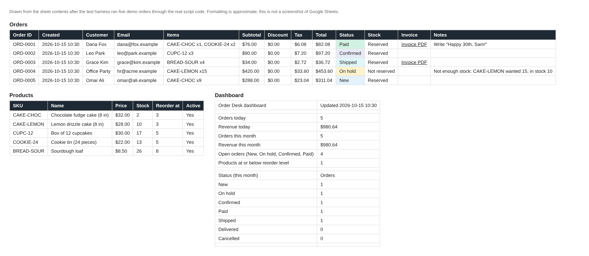
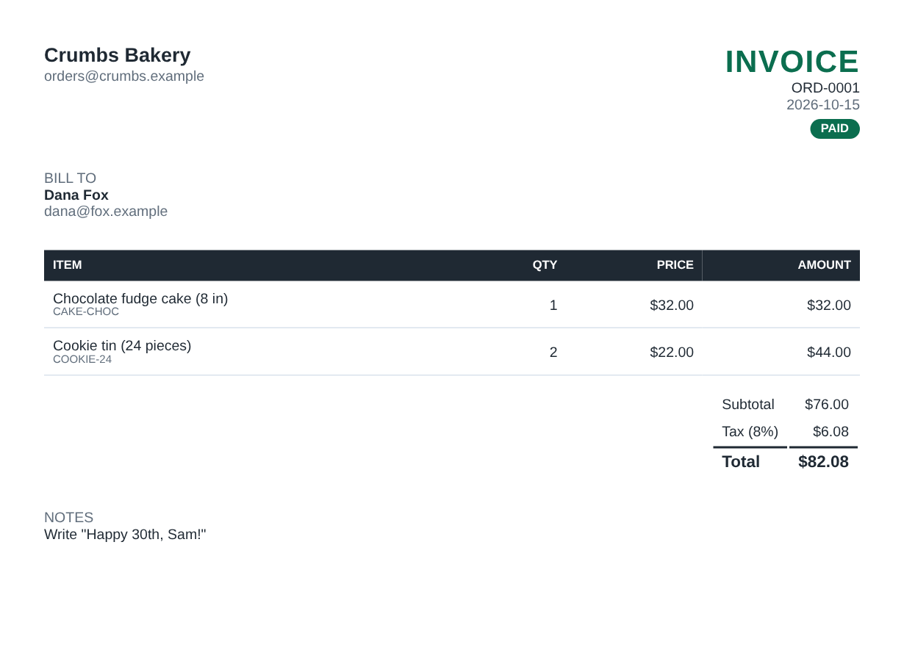
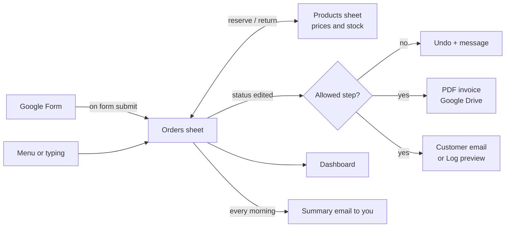
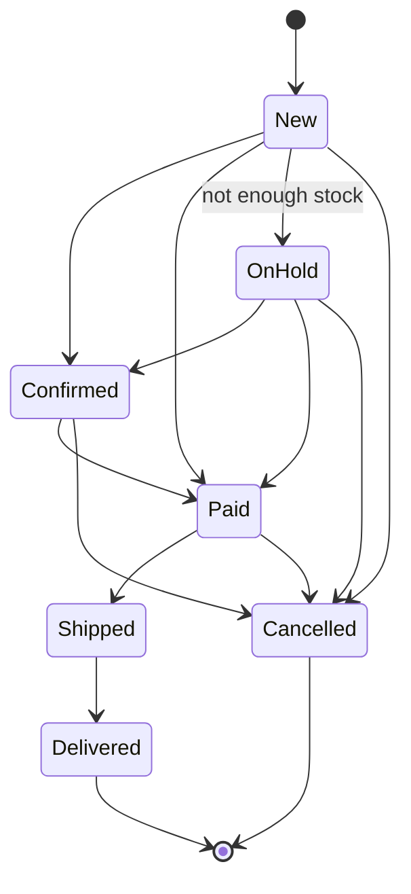

# Order Desk for Google Sheets

**Turn a Google Sheet into a small order system.** Orders arrive from a Google Form, get an ID, a price and tax, and take items out of stock. When you change an order's status, Order Desk saves a PDF invoice to Google Drive and emails the customer, and every morning it emails you a summary. Built with Google Apps Script, so there's nothing to host and nothing to pay for.

[](https://github.com/bikashnayak36331-pixel/sheets-order-desk/actions/workflows/ci.yml)




<sub>Sheet contents after five demo orders went through the real script code in the test harness (`scripts/make-docs.mjs`), drawn as tables. This is not a screenshot of Google Sheets.</sub>

## What it does

- **Setup in one click.** The *Order Desk → Set up* menu builds the Orders, Products, Settings, Dashboard and Log sheets, with currency formats, dropdowns and status colours. It's safe to run again.
- **Orders from a Google Form**, from the menu, or typed in. A form can ask for *Product* + *Quantity*, or for a list such as `CAKE-CHOC x2, CUPC-12`.
- **Automatic maths.** Order IDs (`ORD-0001`…), prices from your Products sheet, optional discount, tax and totals, all calculated in whole cents.
- **Stock that stays right.** Items are reserved when an order comes in. Orders that can't be filled are put *On hold* with a note, and stock goes back automatically when an order is cancelled.
- **Status flow with guard-rails:** New → Confirmed → Paid → Shipped → Delivered (or Cancelled). Skipping a step, such as New → Delivered, is undone with a message explaining what's allowed.
- **PDF invoices in Google Drive**, created when an order is paid (or from the menu) and linked in the sheet.
- **Customer emails** on each status change (new order, confirmed, paid with the invoice attached, shipped, cancelled). **They are off until you switch them on**; until then, each email is previewed in the Log sheet.
- **Dashboard and daily summary:** today's and this month's orders and revenue, open orders, low-stock items, a status chart, and a morning email to you.
- **Nothing gets lost.** An unknown product or a missing email address still saves the order (On hold, with the reason), and two form submissions at once can't get the same ID.

<p align="center"></p>
<p align="center"><sub>The invoice HTML that Order Desk turns into a PDF, rendered in Chrome. Google's PDF converter may differ slightly.</sub></p>

## How it works





## Install (about 5 minutes)

**Option A: copy and paste one file (no tools needed)**

1. Create a Google Sheet, then open **Extensions → Apps Script**.
2. Replace everything in `Code.gs` with [`dist/OrderDesk.gs`](dist/OrderDesk.gs) (also attached to each [release](https://github.com/bikashnayak36331-pixel/sheets-order-desk/releases)). Click **Save**.
3. Reload the spreadsheet. An **Order Desk** menu appears. Click **Order Desk → Set up / repair sheets**.
   - Google asks you to authorise the script. Because it's your own script and not a published app, Google shows "Google hasn't verified this app": choose **Advanced → Go to (project name)**.
4. Fill in the **Settings** sheet (business name, your email, currency symbol, tax rate) and your **Products**.
5. Click **Order Desk → Install automations**. This turns on form orders, status-change actions, the hourly dashboard refresh and the daily summary.
6. *(Optional)* Link a Google Form with **Tools → Create a new form**. Use questions named **Name**, **Email**, **Phone**, **Product** (a dropdown of product names or SKUs) and **Quantity**, or **Items** for a free list, plus **Notes**.

Try it straight away with **Order Desk → Add a test order**.

**Option B: [clasp](https://github.com/google/clasp) (for developers)**

```bash
npx @google/clasp login
cp .clasp.json.example .clasp.json   # then paste your script ID
npm run push                          # uploads src/ in the right order
```

## The sheets

| Sheet | Columns / contents |
|---|---|
| **Orders** | Order ID · Created · Customer · Email · Phone · Items · Discount % · Subtotal · Discount · Tax · Total · **Status** · Stock · Invoice · Notes · Last update |
| **Products** | SKU · Name · Price · Stock · Reorder at · Active |
| **Settings** | Business name · Owner email · Currency symbol · Tax rate % · Order ID prefix · Send customer emails (Yes/No) · Invoice folder · Create invoice when paid · Daily summary hour · Payment instructions |
| **Dashboard** | Orders and revenue today and this month, open orders, low stock, status chart |
| **Log** | Every action, refused edit and email (or email preview), with a timestamp |

You can edit **Items** or **Discount %** while an order is New or On hold, and the totals and stock update. Once an order is confirmed or paid, its items are locked.

## Permissions and limits

Google asks you to approve these when you first run the script:

| Permission | Why |
|---|---|
| This spreadsheet only (`@OnlyCurrentDoc`) | Read and write the Order Desk sheets |
| Google Drive | Save invoice PDFs. Google's screen says "all of your Google Drive files" because that is how Apps Script's Drive service is scoped. Order Desk only creates files in its invoice folder. |
| Send email as you | Customer emails and your daily summary. It cannot read your inbox. |
| Run when you're not present | The triggers for form orders, status edits and the daily summary |

Gmail limits how many emails a script can send per day (see [Apps Script quotas](https://developers.google.com/apps-script/guides/services/quotas)). Order Desk checks the remaining quota and writes to the Log instead of failing.

## Tests

```bash
npm test   # builds dist/OrderDesk.gs, then runs 22 tests with Node's built-in test runner
```

The tests run the **real `src/` files** against an in-memory imitation of Google Sheets, Drive, Gmail, locks and triggers ([`test/fakes.js`](test/fakes.js)), in one shared scope the way Apps Script loads them. The fake throws on any method it doesn't know, so a typo fails here, not in Google. They cover:

- setup;
- form orders;
- tax and discount maths;
- stock reservation and return;
- every status rule;
- invoices, emails and the preview mode;
- triggers, the dashboard and the daily summary;
- the single-file bundle.

These tests don't replace a final check in your own Google account.

## Project layout

```
src/Config.js     sheet names, columns, status flow, defaults
src/Core.js       pure logic: items, prices, tax, IDs, status rules, invoice and email text
src/Sheets.js     reading and writing the sheets, settings, log
src/Setup.js      menu and one-click setup
src/Orders.js     form orders, status changes, item edits, stock
src/Documents.js  PDF invoices in Drive, customer emails
src/Reports.js    dashboard, daily summary, triggers
dist/OrderDesk.gs everything above in one file (npm run build)
```

## Need it customised?

The same approach suits any small business that runs on a spreadsheet. It can be adapted for:

- bookings and appointments;
- quotes;
- repair tickets;
- inventory across locations;
- subscriptions;
- connections to Shopify, Stripe, WhatsApp or Slack.

Open an issue or contact me through my GitHub profile.

## Credits

Built by Bikash Nayak, using Claude (Anthropic) as a coding assistant. Released under the [MIT License](LICENSE).
